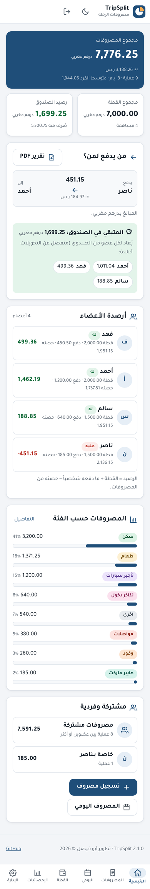
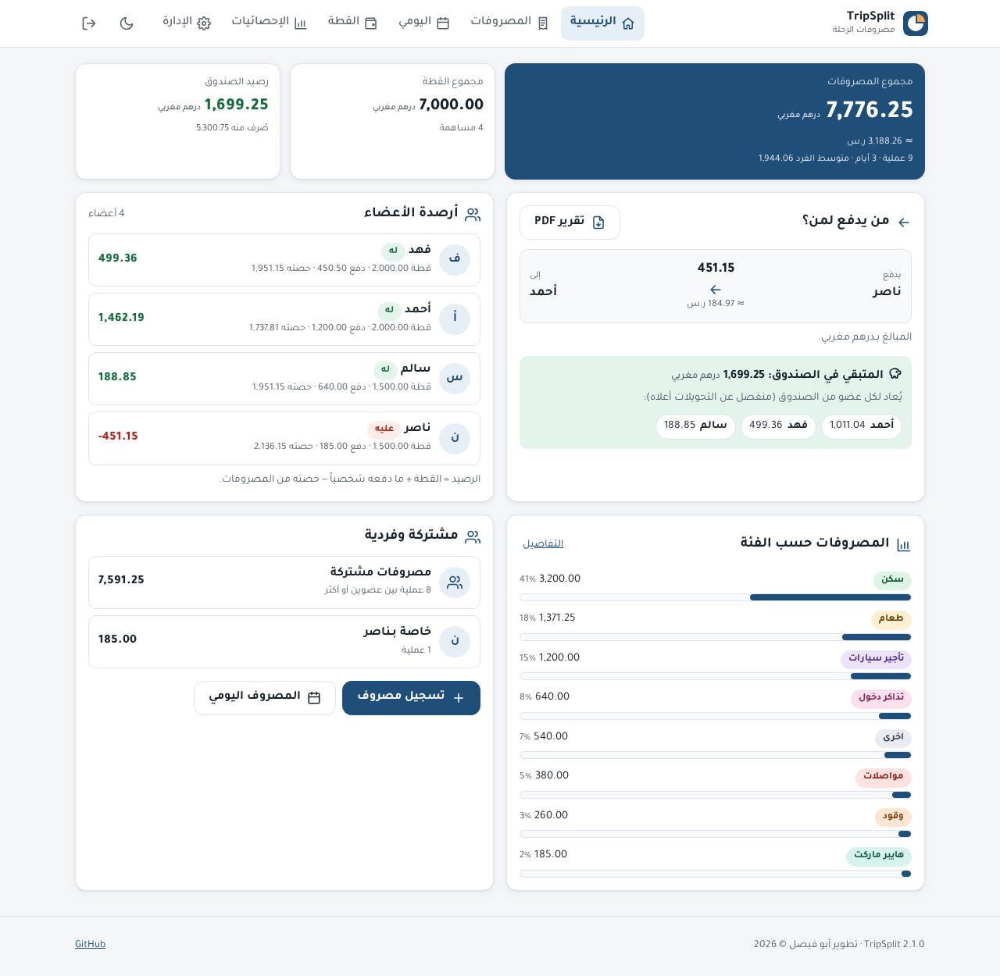

<a id="english"></a>

# TripSplit | قسّم مصاريف الرحلة

**English** · [العربية](#arabic)

A lightweight PHP web app for splitting group‑trip expenses fairly. It supports a shared kitty (القطة) **and** members paying out of pocket, computes who owes whom with the fewest practical transfers, and exports Arabic PDF reports. The UI is Arabic (RTL); data lives in a single JSON file, so no database is needed.

## Contents

- [Overview](#overview)
- [Screenshots / لقطات](#screenshots--لقطات)
- [Features](#features)
- [How the calculation works](#how-the-calculation-works)
- [Requirements](#requirements)
- [Installation](#installation)
- [Usage](#usage)
- [Security notes](#security-notes)
- [Project structure](#project-structure)
- [Running tests](#running-tests)
- [License](#license)
- [Author](#author)

## Overview

Members put money into a shared kitty (**الصندوق**), and expenses are paid either from the kitty or by a member personally. Each expense is split equally among the members who took part in it. TripSplit keeps a running balance per member and for the kitty, then recommends the settlements that close every balance.

## Screenshots / لقطات

<p align="center">
  
  &nbsp;
  
</p>

Dashboard on mobile and desktop: trip totals, a clear **who pays whom** card, member balances, and spending by category. Light and dark themes, bottom navigation on phones.

## Features

- Team management: add, rename (updates every record), and safely delete members.
- Expenses paid by **the kitty** or by **a member personally**, with category, date, and participants.
- Kitty contributions with dates.
- Per‑member balance with status **له** (is owed) / **عليه** (owes) / **متوازن** (settled).
- Kitty balance card, plus how any leftover or shortfall is handled.
- Greedy settlement plan with no zero rows and cent‑exact rounding.
- Dashboard, statistics and charts, daily breakdown, expense and contribution logs.
- PDF exports (full trip report and daily report) via TCPDF.
- Approximate conversion to Saudi riyals using a configurable rate.
- Password login, CSRF protection, protected data folder, automatic backups.
- Mobile‑first Arabic (RTL) interface: one shared layout and navigation, light/dark theme, accessible forms with inline validation, WCAG AA colour contrast, 44px tap targets. No front‑end frameworks or CDNs: plain CSS, a few lines of JS, and the Tajawal font self‑hosted.

## How the calculation works

For every member *m*:

```
net(m) = contributions(m)                       # money m put into the kitty
       + personal_payments(m)                   # expenses m paid out of pocket (source = personal)
       − Σ over expenses m took part in ( amount ÷ number_of_participants )
```

For the kitty:

```
kitty_balance = Σ contributions − Σ expenses paid by the kitty (source = kitty)
```

The sum of all members' `net` always equals `kitty_balance`.

- **Participants**: an expense is split equally among its participants. If the list is missing or empty, the whole team takes part.
- **Statuses**: `net > 0` gives **له**, `net < 0` gives **عليه**, and `0` gives **متوازن**.
- **Rounding**: amounts are handled in cents. Rounding leftovers are distributed (largest remainder), so the nets add up exactly.
- **Settlement**: the largest debtor repeatedly pays the largest creditor. Amounts under 0.01 are skipped, and there are no zero rows.
- **Kitty**: the kitty is not part of member‑to‑member transfers. A leftover is shown as money to refund to contributors. A shortfall is shown as amounts members still owe the kitty.
- **Backward compatibility**: older data has no `source` field. Those expenses are treated as paid **from the kitty**, which keeps old trips' numbers unchanged. They are shown as "Name (من الصندوق)".

### Worked example

Team: Ahmed, Salem, Fahad, Nasser. Ahmed and Salem each put **300** into the kitty.

| Expense | Paid by | Amount | Participants |
|---|---|---|---|
| Lodging | Kitty | 600 | all 4 → 150 each |
| Food | Fahad (personal) | 200 | all 4 → 50 each |

| Member | Contributions | Paid personally | Share | Net | Status |
|---|---|---|---|---|---|
| Ahmed | 300 | 0 | 200 | **+100** | له |
| Salem | 300 | 0 | 200 | **+100** | له |
| Fahad | 0 | 200 | 200 | **0** | متوازن |
| Nasser | 0 | 0 | 200 | **−200** | عليه |

Kitty balance = 600 − 600 = **0**.
Settlement: **Nasser → Ahmed 100**, **Nasser → Salem 100**.

## Requirements

- PHP **7.4+** or **8.x**, with the `json` and `session` extensions (`mbstring` recommended).
- [Composer](https://getcomposer.org/), only for PDF export (installs `tecnickcom/tcpdf ^6.6`).
- A web server: Apache with `.htaccess` enabled is recommended (see the security notes for Nginx).
- No database.

## Installation

```bash
# 1) Get the code
git clone https://github.com/fahad4x4/TripSplit.git
cd TripSplit

# 2) Install the PDF library (creates vendor/)
composer install --no-dev

# 3) Create your private config with a password hash
php tools/hash-password.php > config.local.php
#   or: cp config.local.example.php config.local.php
#       php -r 'echo password_hash("yourpass", PASSWORD_DEFAULT), PHP_EOL;'
#       and paste the hash into config.local.php

# 4) Make the data folder writable by the web server (it is created automatically if missing)
mkdir -p data/backups
chown -R www-data:www-data data      # use your web server's user
chmod 755 data data/backups
```

Edit `config.php` to set the trip currency and exchange rate:

| Key | Meaning |
|---|---|
| `currency` | Currency name shown in the UI and reports (e.g. `درهم مغربي`) |
| `exchange_rate_to_sar` | Value of 1 unit of the trip currency in SAR, used only for the "≈ SAR" hints |
| `admin_name` | Name printed at the end of the PDF report |
| `data_file` | Data file path relative to the project (default `data/expenses.json`) |

Any of these keys can also be overridden in `config.local.php`.

**Upgrading from an older version:** if an `expenses.json` exists in the project root and `data/expenses.json` does not, it is copied to `data/` automatically on first load. Once you have checked the data, delete the old root file and the old `backups/` folder.

## Usage

1. Open `login.php` and sign in.
2. Go to **صفحة الإدارة** (`manage.php`):
   - add members;
   - record kitty contributions;
   - record expenses: choose **الصندوق** if the kitty paid, or a member's name if that member paid personally, then tick the participants (none ticked = the whole team);
   - rename or delete members.
3. `index.php` shows totals, the kitty balance, each member's balance, and the required transfers.
4. `Chart.php` holds the statistics, `expenses.php` / `contributions.php` the logs, and `daily_expenses.php` the daily view.
5. `export.php` produces the full PDF report, and `daily-pdf.php` the daily PDF.

Deleting a member is refused while they have contributions or payments. If they only took part in expenses, tick **إعادة توزيع حصته** to remove them from those expenses and re‑split the cost among the remaining participants. This is refused if any expense would be left with no participants.

## Security notes

- Every page goes through `auth.php`: the session cookie is `HttpOnly` and `SameSite=Lax`, and also `Secure` over HTTPS. Logged‑out visitors are redirected to the login page (AJAX requests get a 401).
- The password is stored only as a `password_hash` in `config.local.php`, which is git‑ignored. Login uses `password_verify` and `session_regenerate_id(true)`, adds an increasing delay after failures, and locks for 5 minutes after 5 failed attempts in a session. If `config.local.php` is missing, login is disabled and a setup message is shown.
- All state‑changing requests (`save.php`, `reset.php`, `logout.php`, login) are **POST‑only with a CSRF token**. Reset also asks for confirmation in the browser and takes a backup first.
- Data is stored in `data/expenses.json`, with a backup in `data/backups/` before every write, using `LOCK_EX` plus a lock file. `data/.htaccess` denies web access on Apache 2.4 (`Require all denied`) and 2.2 (`Deny from all`).
- **Nginx** does not read `.htaccess`. Add equivalent rules, for example:
  `location ~ ^/(data|vendor|tests|tools)/ { deny all; }` and `location = /config.local.php { deny all; }`.
- `display_errors` is off and errors go to the server log. All output is escaped with `htmlspecialchars`, and JSON in scripts uses `JSON_HEX_*` flags.
- Always serve the app over HTTPS.

## Project structure

```
TripSplit/
├── index.php                 Dashboard: totals, kitty balance, member balances, settlements
├── manage.php                Admin forms (members, expenses, contributions, rename/delete, reset)
├── save.php                  POST endpoint for manage.php (CSRF-protected)
├── reset.php                 POST-only reset with backup (CSRF-protected)
├── login.php / logout.php    Authentication
├── Chart.php                 Statistics: member table, category and daily bars, settlements
├── expenses.php              Expense log
├── contributions.php         Contribution log
├── daily_expenses.php        Daily breakdown
├── export.php                Full PDF report (TCPDF)
├── daily-pdf.php             Daily PDF report (TCPDF)
├── functions.php             Calculation logic (single source of truth, no side effects)
├── storage.php               Load/save JSON, backups, locking, legacy migration
├── auth.php                  Session, login guard, CSRF helpers, escaping, config loader
├── config.php                Public settings (currency, exchange rate, …)
├── config.local.example.php  Template for the private config (password hash)
├── composer.json / .lock     PHP dependencies (TCPDF)
├── ui.php                    Shared layout: header, navigation, footer, money formatting, icons
├── assets/                   app.css, app.js, favicon.svg, fonts/ (Tajawal, OFL)
├── docs/screenshots/         README screenshots
├── .htaccess                 Blocks sensitive root files on Apache
├── data/
│   ├── .htaccess             Deny all web access
│   └── expenses.example.json Sample data (old format, no "source")
├── tools/hash-password.php   CLI helper that prints a config.local.php with a hash
└── tests/test_logic.php      Framework-free logic tests
```

Git‑ignored: `config.local.php`, `data/expenses.json`, `data/backups/`, `vendor/`.

## Running tests

```bash
php tests/test_logic.php
```

The tests cover a kitty‑only trip, personal payments, an expense with 2 of 3 participants, rounding (100 ÷ 3), settlements clearing every balance with no zero rows, old data without `source` or `participants`, input validation, rename, and delete rules. The exit code is non‑zero if any test fails.

## License

Released under the [MIT License](LICENSE). Copyright © 2026 Fahad ALGhathbar (فهد الغثبر).

## Author

**Fahad ALGhathbar / فهد الغثبر**: [github.com/fahad4x4](https://github.com/fahad4x4)

---

<a id="arabic"></a>

<div dir="rtl">

# العربية

[English](#english)

## المحتويات

- [نبذة](#نبذة)
- [الخصائص](#الخصائص)
- [كيف تتم الحسابات](#كيف-تتم-الحسابات)
- [المتطلبات](#المتطلبات)
- [التثبيت](#التثبيت)
- [طريقة الاستخدام](#طريقة-الاستخدام)
- [ملاحظات الأمان](#ملاحظات-الأمان)
- [هيكل المشروع](#هيكل-المشروع)
- [تشغيل الاختبارات](#تشغيل-الاختبارات)
- [الترخيص](#الترخيص)
- [المطور](#المطور)

## نبذة

**TripSplit** تطبيق PHP خفيف لتقسيم مصاريف الرحلات الجماعية بعدل. يدعم **القطة المشتركة (الصندوق)** ويدعم أيضاً **الدفع الشخصي** من أحد الأعضاء. يحسب رصيد كل عضو ورصيد الصندوق، ثم يقترح التحويلات التي تُصفّي الحسابات. تقاريره بصيغة PDF عربية.

لا يحتاج التطبيق قاعدة بيانات، فالبيانات محفوظة في ملف JSON واحد.

## الخصائص

- إدارة الفريق: إضافة عضو، وتعديل الاسم (يتحدث في كل السجلات)، وحذف آمن.
- تسجيل المصروفات مدفوعةً من **الصندوق** أو **شخصياً** من عضو، مع النوع والتاريخ والمشاركين.
- تسجيل مساهمات القطة مع التاريخ.
- رصيد لكل عضو بحالة موحدة: **له** / **عليه** / **متوازن**.
- بطاقة لرصيد الصندوق، مع عرض الفائض أو العجز.
- خطة تسوية مختصرة بلا صفوف صفرية، وبتقريب دقيق للهللة.
- لوحة إحصائيات ورسوم بيانية، وعرض يومي، وسجلات للمصروفات والمساهمات.
- تصدير PDF (التقرير الكامل والتقرير اليومي) عبر مكتبة TCPDF.
- عرض المبلغ التقريبي بالريال السعودي حسب سعر صرف قابل للتعديل.
- تسجيل دخول بكلمة مرور، وحماية CSRF، ومجلد بيانات محمي، ونسخ احتياطي تلقائي.
- واجهة عربية متجاوبة للجوال أولاً: تصميم وتنقل موحّد، وضع ليلي، نماذج واضحة مع رسائل تحقق، تباين ألوان WCAG AA. بدون مكتبات أو CDN: CSS عادي وسطور JavaScript قليلة وخط Tajawal مستضاف محلياً.

لقطات الشاشة: انظر [Screenshots / لقطات](#screenshots--لقطات).

## كيف تتم الحسابات

لكل عضو:

```
الصافي = مساهماته في الصندوق
       + ما دفعه شخصياً من مصروفات (source = personal)
       − مجموع حصته من كل مصروف شارك فيه (المبلغ ÷ عدد المشاركين)
```

وللصندوق:

```
رصيد الصندوق = مجموع المساهمات − مصروفات الصندوق (source = kitty)
```

مجموع صافي الأعضاء يساوي دائماً رصيد الصندوق.

- **المشاركون**: يُقسم كل مصروف بالتساوي على المشاركين فيه. إذا لم يُحدَّد أحد، يُقسم على الفريق كله.
- **الحالة**: الصافي الموجب يعني **له**، والسالب يعني **عليه**، والصفر يعني **متوازن**.
- **التقريب**: الحساب بالهللات (السنتات)، وتُوزَّع فروقات التقريب بحيث يتطابق المجموع تماماً.
- **التسوية**: أكبر مدين يدفع لأكبر دائن، وهكذا حتى تنتهي الأرصدة. تُتجاهل المبالغ الأقل من 0.01، ولا تظهر صفوف صفرية.
- **الصندوق**: لا يدخل في التحويلات بين الأعضاء. إذا بقي فيه مبلغ فهو فائض يُعاد للمساهمين، وإذا نقص فهو عجز يغطيه الأعضاء.
- **التوافق مع البيانات القديمة**: المصروفات القديمة التي ليس فيها حقل `source` تُعامل كأنها دُفعت من الصندوق، فلا تتغير أرقام الرحلات السابقة. تظهر بصيغة "الاسم (من الصندوق)".

### مثال محلول

الفريق: أحمد، سالم، فهد، ناصر. ساهم كل من أحمد وسالم بـ **300** في الصندوق.

| المصروف | الدافع | المبلغ | المشاركون |
|---|---|---|---|
| سكن | الصندوق | 600 | الأربعة → 150 لكل واحد |
| طعام | فهد (شخصياً) | 200 | الأربعة → 50 لكل واحد |

| العضو | المساهمة | دفع شخصياً | الحصة | الصافي | الحالة |
|---|---|---|---|---|---|
| أحمد | 300 | 0 | 200 | **+100** | له |
| سالم | 300 | 0 | 200 | **+100** | له |
| فهد | 0 | 200 | 200 | **0** | متوازن |
| ناصر | 0 | 0 | 200 | **−200** | عليه |

رصيد الصندوق = 600 − 600 = **0**.
التسوية: **ناصر ← أحمد 100**، و**ناصر ← سالم 100**.

## المتطلبات

- PHP إصدار **7.4** أو أحدث (يعمل على **8.x**)، مع الامتدادين `json` و`session` (ويُفضّل `mbstring`).
- Composer لتثبيت مكتبة PDF (`tecnickcom/tcpdf ^6.6`).
- خادم ويب: يُفضّل Apache مع تفعيل `.htaccess`. لخادم Nginx راجع قسم الأمان.
- لا حاجة لقاعدة بيانات.

## التثبيت

1. انسخ المشروع إلى خادمك.
2. ثبّت مكتبة PDF:

   ```bash
   composer install --no-dev
   ```

3. أنشئ ملف الإعدادات الخاص بكلمة المرور (لا يُرفع إلى Git):

   ```bash
   php tools/hash-password.php > config.local.php
   ```

   أو انسخ `config.local.example.php` إلى `config.local.php`، ثم ضع فيه الناتج من الأمر:

   ```bash
   php -r 'echo password_hash("كلمة_المرور", PASSWORD_DEFAULT), PHP_EOL;'
   ```

4. امنح خادم الويب صلاحية الكتابة على مجلد `data/`:

   ```bash
   mkdir -p data/backups
   chown -R www-data:www-data data
   chmod 755 data data/backups
   ```

5. عدّل العملة وسعر الصرف في `config.php`:
   - `currency`: اسم العملة.
   - `exchange_rate_to_sar`: قيمة الوحدة الواحدة بالريال، وتُستخدم للعرض التقريبي فقط.
   - `admin_name`: الاسم الذي يظهر في ختام التقرير.

**الترقية من إصدار سابق:** إذا وُجد ملف `expenses.json` في جذر المشروع ولم يوجد `data/expenses.json`، يُنسخ الملف تلقائياً عند أول فتح. بعد التأكد من سلامة البيانات احذف الملف القديم من الجذر واحذف مجلد `backups/` القديم.

## طريقة الاستخدام

1. سجّل الدخول من `login.php`.
2. افتح **صفحة الإدارة**:
   - أضف الأعضاء.
   - سجّل مساهمات القطة.
   - سجّل المصروفات: اختر **الصندوق** إذا دُفع المصروف من القطة، أو اسم العضو إذا دفعه من جيبه. ثم حدّد المشاركين، وإذا لم تحدد أحداً يُقسم على الفريق كله.
   - عدّل أسماء الأعضاء أو احذفهم.
3. في الصفحة الرئيسية تجد المجاميع، ورصيد الصندوق، ورصيد كل عضو، والتحويلات المطلوبة.
4. صفحات الإحصائيات والسجلات والعرض اليومي متاحة من الرئيسية، ومنها أيضاً تصدير تقارير PDF.

**عن حذف الأعضاء:** يُرفض حذف عضو له مساهمات أو مدفوعات. إذا كان مشاركاً في مصروفات فقط، فعّل خيار **إعادة توزيع حصته** ليُزال من تلك المصروفات وتُقسم على البقية. ويُرفض الحذف إذا كان سيبقى مصروف بلا مشاركين.

## ملاحظات الأمان

- **الجلسة**: كل الصفحات محمية عبر `auth.php`. كعكة الجلسة `HttpOnly` و`SameSite=Lax`، وتكون `Secure` عند استخدام HTTPS.
- **كلمة المرور**: تُحفظ بصيغة `password_hash` فقط في `config.local.php`.
- **تسجيل الدخول**: يتحقق بـ `password_verify` ويجدد معرّف الجلسة بعد الدخول. بعد أي محاولة فاشلة يتأخر الرد قليلاً، وبعد 5 محاولات فاشلة يُقفل الدخول 5 دقائق.
- **قبل التهيئة**: إذا لم يوجد `config.local.php` يُعطّل الدخول وتظهر رسالة تهيئة.
- **الطلبات المعدِّلة**: الحفظ وإعادة الضبط والخروج تقبل **POST فقط** مع رمز CSRF. إعادة الضبط تطلب تأكيداً في المتصفح وتأخذ نسخة احتياطية قبل المسح.
- **البيانات**: تُحفظ في `data/expenses.json` مع قفل للكتابة، وتُؤخذ نسخة احتياطية قبل كل حفظ. ملف `data/.htaccess` يمنع الوصول المباشر من الويب.
- **خادم Nginx**: لا يقرأ ملفات `.htaccess`، فأضف قواعد منع مماثلة لمجلدات `data` و`vendor` و`tests` و`tools` ولملف `config.local.php`.
- **الأخطاء والمخرجات**: عرض الأخطاء معطّل، وتُسجَّل الأخطاء في سجل الخادم. كل المخرجات مُهرّبة بـ `htmlspecialchars`.
- **HTTPS**: استخدمه دائماً.

## هيكل المشروع

انظر الشجرة في القسم الإنجليزي: [Project structure](#project-structure).

أهم الملفات:

- `functions.php`: منطق الحسابات (المصدر الوحيد).
- `storage.php`: التخزين والنسخ الاحتياطي.
- `auth.php`: الأمان.
- `manage.php` و`save.php`: الإدارة.
- `tests/test_logic.php`: الاختبارات.

## تشغيل الاختبارات

```bash
php tests/test_logic.php
```

تغطي الاختبارات:

- رحلة بالقطة فقط.
- الدفع الشخصي.
- مصروف يشارك فيه عضوان من ثلاثة.
- التقريب (100 ÷ 3).
- تصفية كل الأرصدة بلا تحويلات صفرية.
- البيانات القديمة التي ليس فيها `source` أو مشاركون.
- التحقق من المدخلات، وتعديل الأسماء، وقواعد الحذف.

## الترخيص

المشروع منشور برخصة [MIT](LICENSE). حقوق النشر © 2026 فهد الغثبر (Fahad ALGhathbar).

## المطور

**فهد الغثبر / Fahad ALGhathbar**: [github.com/fahad4x4](https://github.com/fahad4x4)

</div>
